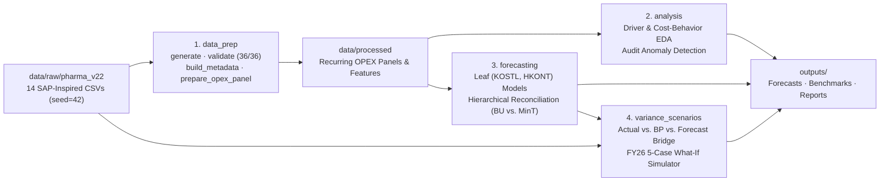

# SAP Pharma OPEX Forecasting & Financial Intelligence

End-to-end pharmaceutical OPEX forecasting, audit anomaly detection, hierarchical reconciliation (Bottom-Up vs. MinT), and driver-based What-If scenario engine built on an SAP S/4HANA-inspired Universal Journal (`ACDOCA` / `COOI`) pipeline for a **Global Pharmaceutical Enterprise**.

> [!NOTE]
> **Synthetic Data Disclaimer & Attribution**
> All 14 tables in `data/raw/pharma_v22/` are **deterministically generated synthetic datasets (`seed = 42`)** containing **no real company, client, or SAP customer data**. Structural driver equations model realistic pharmaceutical FP&A patterns (`Innovative_Medicine`, `MedTech`, `Enterprise_Corporate` segments and `BP` / `Q1_RF` / `JU` / `Q3_RF` / `NU` planning cadences) for benchmarking and demonstration only.
>
> Initial SAP FI/CO schema design inspiration is credited to [`sapajaykumar/sap-fpa-dataset`](https://github.com/sapajaykumar/sap-fpa-dataset) (MIT / CC BY 4.0).

---

## Architecture



---

## Headline Results

| Workstream | Metric | Benchmark | Model / Output | Status |
| :--- | :--- | :--- | :--- | :--- |
| **1. Data & Accounting Gate** | Double-entry balance, PIT cutoffs, PO/accrual integrity | `36` schema & accounting checks | `36/36` passing (`validate_dataset.py`) | **Live** |
| **2. Audit Anomaly Detection** | Precision / Recall / F1 across 4 anomaly classes | `104` labeled anomalies (`eval_anomaly_labels.csv`) | Unsupervised rules + ML scoring | *Planned* |
| **3. Open-Horizon Forecasting** | WAPE, Bias %, Forecast Value Added (FVA) | `BP` (`VERSION=1`) & Rolling Forecasts (`Q1_RF`–`NU`) | Leaf `(KOSTL, HKONT)` statistical & ML models | *Planned* |
| **4. Hierarchical Reconciliation** | Coherent WAPE across `Cost Center -> Franchise -> Segment` | Bottom-Up baseline | `hierarchical_reconciliation.py` (Bottom-Up vs. MinT) | *Planned* |
| **5. FY26 What-If Scenarios** | Operational & FX USD impact deltas vs. `BASE` | `BASE` FY26 forward projection | `HIRING_FREEZE_Q2`, `PHASE3_DELAY_1Q`, `USD_STRENGTHEN_10PCT`, `LAUNCH_ACCEL` | *Planned* |

---

## Enterprise Accounting & Anti-Leakage Guardrails

- **Point-in-Time `CPUDT` Cutoffs & Regular Periods:** Filter `CPUDT <= snapshot_date` and `POPER <= 12` (excluding special audit periods `13–16`) so backtests reflect only information entered by each planning cutoff.
- **Single-Snapshot `COOI` PO Commitments:** Filter `fact_po_commitments.csv` to a single `SNAPSHOT_DATE` per forecast origin before summing `OPEN_COMMITMENT_USD` to prevent multi-month double counting.
- **GAAP vs. Adjusted Operational Separation:** Isolate non-recurring GAAP events (`SPECIAL_ITEM_FLAG != "NONE"`) from recurring run-rate OPEX (`SPECIAL_ITEM_FLAG == "NONE"`).
- **Constant-FX Variance Isolation:** Separate operational performance (`KSL_BUDGET_FX` at locked annual `BUDGET_PLAN` FX) from currency translation effects (`KSL` at `ACTUAL_AVG` FX).

---

## Interactive Notebooks & Documentation Index

| Resource | Purpose | Status |
| :--- | :--- | :--- |
| [notebooks/00_sap_column_reference.ipynb](notebooks/00_sap_column_reference.ipynb) | Interactive SAP ↔ readable (`UPPER_SNAKE`) crosswalk, `DOCLN`/`BUZEI` dtype check, anti-leakage cheat sheet | **Live** |
| [notebooks/01_opex_data_preparation.ipynb](notebooks/01_opex_data_preparation.ipynb) | Stage 1 exploration & canonical 4-condition recurring OPEX filter | **Starter** *(full Stage 1 pending)* |
| `notebooks/02_opex_and_driver_analysis.ipynb` | Cost-behavior segmentation, driver correlations & anomaly EDA | *Planned* |
| `notebooks/03_forecasting_models.ipynb` | Leaf `(KOSTL, HKONT)` model training & `BP`/`RF` backtesting | *Planned* |
| `notebooks/04_hierarchical_reconciliation.ipynb` | Monthly & quarterly Bottom-Up vs. MinT reconciliation benchmark | *Planned* |
| `notebooks/05_variance_and_scenario_analysis.ipynb` | Variance bridges & FY26 5-scenario executive simulations | *Planned* |
| [docs/sap_pharma_opex_data_dictionary.md](docs/sap_pharma_opex_data_dictionary.md) | Complete 14-table, 206-column field & accounting specification | **Live** |
| [docs/sap_column_crosswalk.csv](docs/sap_column_crosswalk.csv) | Flat 206-row SAP ↔ readable lookup table | **Live** |
| [AGENTS.md](AGENTS.md) | Compact engineering & anti-leakage rules for coding sessions | **Live** |

---

## Quickstart

```bash
# 1. Install editable package and JupyterLab environment (uv or pip)
uv sync --extra dev
# Or with standard pip:
# pip install -e ".[dev]"

# 2. Validate the raw v2.2 dataset (36/36 checks)
python src/opex_forecast/data_prep/validate_dataset.py

# 3. (Optional) Regenerate deterministic seed=42 CSVs & refresh metadata catalogs
# python src/opex_forecast/data_prep/generate_dataset.py --seed 42
# python src/opex_forecast/data_prep/build_metadata.py --markdown docs/sap_pharma_opex_data_dictionary.md

# 4. Open Notebook Zero in JupyterLab
uv run jupyter lab notebooks/00_sap_column_reference.ipynb
```
